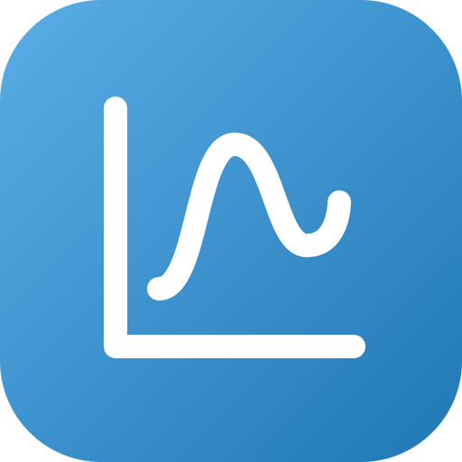

# go-plot — brand assets

Official logos for the **go-plot** organization.

The mark is a plot: two axes and a curve. Its gradient (`#5AAEE6` to
`#1F77B4`) ends on matplotlib's `tab:blue`, `C0`, the colour go-plot gives the
first line of every figure, as matplotlib does. It sets go-plot apart from the
emerald of its scientific-computing siblings go-ndarray, go-fft and
go-notebook.

## Formats

- **SVG** — `svg/color`, `svg/white` (white, transparent), `svg/black` (black, transparent)
- **PNG** 16→1024 px, 3 variants — `png/<variant>/<size>/`
- **JPG** (color, white background) — `jpg/<size>/`
- **ICO** (Windows) — `ico/`
- **ICNS** (macOS) — `icns/`
- **GitHub avatar** 512 px — `avatar/`
- **Social preview** 1280×640 (repo banner) — `social/`

`check/kit.py` counts the whole matrix on every pull request.

---
*Generated from `svg/color/go-plot.svg` by the fleet's Go brand pipeline (brandgen) — rounded square badge, line glyph, color / white / black variants.*
